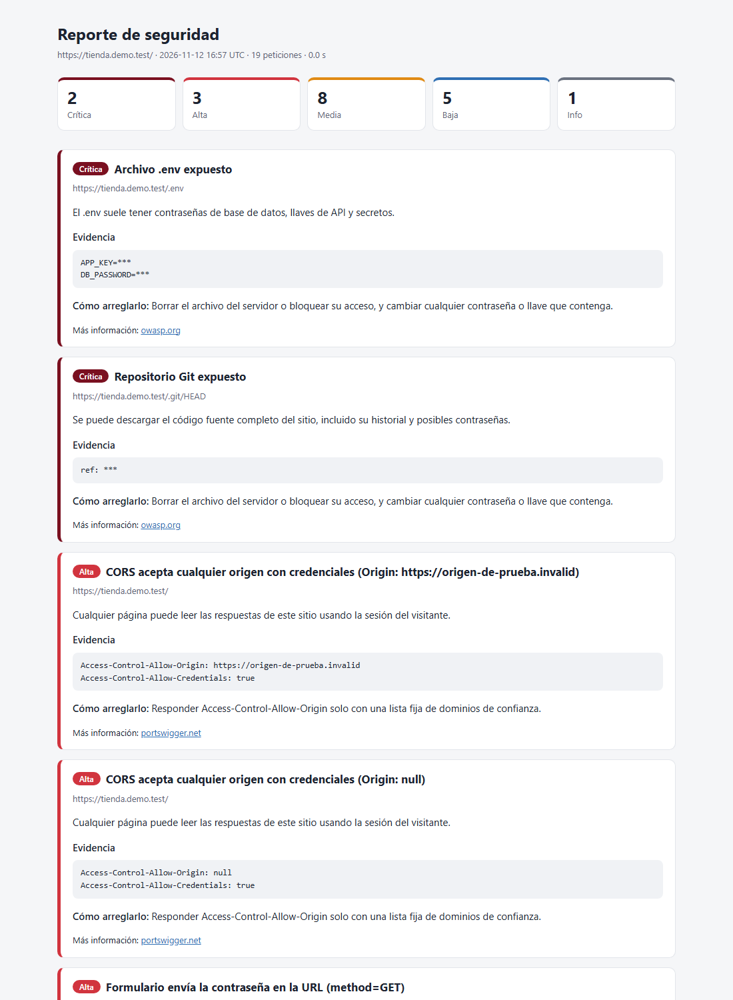
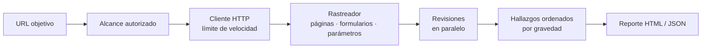

<div align="center">

# escaner-web

**Escáner de vulnerabilidades web en Python, con reportes claros en español.**

Revisa la configuración de seguridad de un sitio, recorre sus páginas y genera un reporte con cada problema, su gravedad y cómo arreglarlo. Incluye una revisión especializada para proyectos de **Firebase**.

[](https://github.com/yeisondev001/escaner-web/actions/workflows/pruebas.yml)


</div>

---

> [!WARNING]
> **Úsalo solo en sitios propios o con permiso escrito del dueño.** Escanear sistemas ajenos sin autorización es un delito en la mayoría de los países (en República Dominicana, Ley 53-07). La herramienta está diseñada para no salir nunca de los dominios autorizados, pero la responsabilidad del uso es de quien la ejecuta.

## Tabla de contenido

- [Características](#características)
- [Ejemplo de reporte](#ejemplo-de-reporte)
- [Instalación](#instalación)
- [Uso](#uso)
- [Revisiones incluidas](#revisiones-incluidas)
- [Cómo funciona](#cómo-funciona)
- [Diseño seguro](#diseño-seguro)
- [Agregar una revisión](#agregar-una-revisión)
- [Pruebas](#pruebas)
- [Hoja de ruta](#hoja-de-ruta)
- [Limitaciones conocidas](#limitaciones-conocidas)

## Características

- **Rastreo del sitio**: descubre páginas, formularios y parámetros siguiendo enlaces, `sitemap.xml` y `robots.txt`.
- **8 revisiones pasivas**: HTTPS y certificado, cabeceras de seguridad, cookies, CORS, información expuesta, formularios, archivos sensibles y Firebase.
- **Especializado en Firebase**: detecta el proyecto del sitio y comprueba si Firestore, Realtime Database o Storage se pueden leer sin iniciar sesión.
- **Pocos falsos positivos**: los archivos expuestos se confirman por su contenido (no basta un `200`), y los formularios manejados por JavaScript se distinguen de los que envía el navegador.
- **Reportes en HTML y JSON**, ordenados por gravedad, con evidencia y recomendación concreta. Los secretos y datos personales se ocultan.
- **Listo para CI**: `--fallar-en alta` hace que el comando termine con error si aparecen hallazgos graves.

## Ejemplo de reporte

Reporte generado contra un sitio **simulado** con fallas a propósito ([`docs/demo.py`](docs/demo.py)):

<p align="center"></p>

## Instalación

Requiere Python 3.11 o superior.

```bash
git clone https://github.com/yeisondev001/escaner-web.git
cd escaner-web
python -m venv .venv
.venv\Scripts\activate          # Windows
# source .venv/bin/activate     # Linux / macOS
pip install -e ".[dev]"
```

## Uso

```bash
escaner escanear https://misitio.com
```

Antes de empezar, el escáner muestra el alcance y pide confirmar que tienes permiso. Al terminar deja `reporte.html` en la carpeta actual.

```text
Escaneando https://misitio.com con 8 revisiones…
  ✓ Rastreo (24 páginas, 3 formularios)
  ✓ Cabeceras de seguridad (2 hallazgos)
  ✓ Formularios (1 hallazgos)
  …
                 5 hallazgos · 61 peticiones
┌───────────┬─────────────────────────────────────┬─────────────┐
│ Severidad │ Hallazgo                            │ Revisión    │
├───────────┼─────────────────────────────────────┼─────────────┤
│ Media     │ Formulario POST sin token anti-CSRF │ formularios │
│ Media     │ Falta Content-Security-Policy (CSP) │ cabeceras   │
└───────────┴─────────────────────────────────────┴─────────────┘
```

### Opciones

| Opción | Descripción | Por defecto |
|---|---|---|
| `--reporte RUTA` | Archivo HTML del reporte | `reporte.html` |
| `--json RUTA` | Guardar también el resultado en JSON | — |
| `--paginas N` | Máximo de páginas a recorrer (`1` = solo la principal) | `30` |
| `--profundidad N` | Clics de distancia desde la página principal | `3` |
| `--velocidad N` | Máximo de peticiones por segundo | `5` |
| `--permitir DOMINIO` | Autorizar otro dominio (repetible; acepta `*.dominio.com`) | — |
| `--firebase` | Revisar también el proyecto de Firebase del sitio (solo lectura) | desactivado |
| `--solo ID` | Correr solo algunas revisiones (repetible) | todas |
| `--fallar-en NIVEL` | Salir con código 1 si hay hallazgos de ese nivel o mayor | — |
| `--tengo-permiso` | Omitir la confirmación interactiva | — |

`escaner revisiones` lista los identificadores disponibles.

### En integración continua

```yaml
- run: escaner escanear https://staging.misitio.com --tengo-permiso --fallar-en alta --json resultado.json
```

## Revisiones incluidas

| ID | Qué revisa | Niveles posibles |
|---|---|---|
| `tls` | Redirección de HTTP a HTTPS, certificado inválido o próximo a vencer, TLS 1.0/1.1 | Alta · Media |
| `cabeceras` | HSTS, Content-Security-Policy, protección contra clickjacking, `nosniff`, Referrer-Policy, Permissions-Policy | Media · Baja · Info |
| `cookies` | Cookies sin `Secure`, `HttpOnly` o `SameSite`, con más peso si parecen de sesión | Media · Baja · Info |
| `cors` | Servidores que aceptan cualquier `Origin` (incluido `null`), sobre todo con credenciales | Alta · Baja |
| `divulgacion` | Versiones de servidor o PHP expuestas, listado de directorios, contenido mixto, contraseñas sin cifrar, jQuery con CVE conocidos | Alta · Media · Baja |
| `formularios` | Formularios POST sin token anti-CSRF, contraseñas enviadas en la URL | Alta · Media · Baja |
| `archivos` | `.git`, `.env`, respaldos SQL/ZIP, `phpinfo`, `server-status`, `.DS_Store`, `.htaccess`, configuraciones de VS Code | Crítica · Alta · Media · Baja |
| `firebase` | Lectura pública de Realtime Database, colecciones de Firestore y listado de Storage | Crítica · Alta · Media · Info |

## Cómo funciona



```text
escaner/
├── alcance.py       Dominios autorizados (exactos o *.comodín)
├── cliente.py       HTTP asíncrono: alcance en cada redirección, límite de velocidad y de tamaño
├── rastreador.py    Recorre el sitio y arma el mapa
├── motor.py         Orquesta el rastreo y las revisiones
├── modelos.py       Hallazgo, Severidad, Mapa, Resultado (Pydantic)
├── revisiones/      Una revisión por archivo
├── reportes/        Reporte HTML (Jinja2) y JSON
└── cli.py           Comandos de consola (Typer + Rich)
```

**Tecnologías:** [httpx](https://www.python-httpx.org/) (HTTP asíncrono), [selectolax](https://github.com/rushter/selectolax) (lectura de HTML), [Pydantic](https://docs.pydantic.dev/) (modelos), [Typer](https://typer.tiangolo.com/) y [Rich](https://github.com/Textualize/rich) (consola), [Jinja2](https://jinja.palletsprojects.com/) (reporte), [pytest](https://pytest.org/) (pruebas).

## Diseño seguro

El escáner está pensado para que sea difícil usarlo mal por accidente:

- **Alcance obligatorio.** Toda petición pasa por el cliente, que rechaza cualquier URL fuera de los dominios autorizados, también cuando el sitio redirige a otro lado.
- **Solo lectura.** Todas las revisiones actuales hacen peticiones `GET`. Los formularios se registran pero no se envían.
- **Enlaces peligrosos omitidos.** El rastreador no abre enlaces que parezcan cerrar sesión o borrar datos (`/logout`, `/eliminar?id=…`), porque en sitios mal diseñados un `GET` puede tener efectos.
- **Firebase solo con permiso explícito.** Los servicios de Google solo entran en el alcance con `--firebase`.
- **Sin secretos en los reportes.** Se ocultan los valores de cookies y de archivos expuestos; de Firebase se reportan nombres de campos y conteos, nunca los datos.
- **Velocidad limitada** a 5 peticiones por segundo por defecto, para no afectar al sitio.

## Agregar una revisión

Cada revisión es una clase independiente. Crear `escaner/revisiones/mi_revision.py`:

```python
from escaner.modelos import Hallazgo, Severidad
from escaner.revisiones.base import Revision, Sitio


class MiRevision(Revision):
    id = "mi-revision"
    nombre = "Descripción corta"

    async def ejecutar(self, sitio: Sitio, cliente) -> list[Hallazgo]:
        hallazgos = []
        for pagina in sitio.paginas:            # todas las páginas que encontró el rastreador
            if "algo-inseguro" in pagina.texto:
                hallazgos.append(Hallazgo(
                    revision=self.id, titulo="…", severidad=Severidad.MEDIA, url=pagina.url,
                    descripcion="Qué pasa y por qué importa.",
                    recomendacion="Cómo arreglarlo."))
        return hallazgos
```

Registrarla en `TODAS` dentro de `escaner/revisiones/__init__.py` y agregar su prueba en `tests/`.

## Pruebas

```bash
pytest -q
```

Las pruebas usan un servidor simulado (`httpx.MockTransport`), así que **no tocan ningún sitio real** y corren en segundos. Cubren el control de alcance, la ausencia de falsos positivos, el ocultamiento de secretos, el rastreador y cada revisión. Se ejecutan automáticamente en GitHub Actions con Python 3.11, 3.12 y 3.13.

## Hoja de ruta

- [x] Revisiones pasivas: TLS, cabeceras, cookies, CORS, información expuesta, archivos sensibles
- [x] Revisión de Firebase (Firestore, Realtime Database, Storage)
- [x] Rastreador de páginas, formularios y parámetros
- [ ] Rastreo de aplicaciones de una sola página con navegador real (Playwright)
- [ ] Revisiones activas: XSS reflejado, inyección SQL por errores, open redirect (probadas contra OWASP Juice Shop y DVWA)
- [ ] Firebase: bases de datos con nombre, escritura pública y registro abierto
- [ ] API (FastAPI) con cola de trabajos e historial en PostgreSQL
- [ ] Panel web (React) para administrar sitios y comparar escaneos

## Limitaciones conocidas

- Las aplicaciones de una sola página (React, Angular, Flutter Web) generan sus enlaces con JavaScript; sin navegador, el rastreador ve pocas páginas.
- La revisión de Firestore prueba la base `(default)` con los nombres de colección que aparecen en el código del sitio y una lista de nombres comunes; no puede listar colecciones que no conoce.
- No reemplaza una auditoría manual ni una prueba de penetración profesional.
